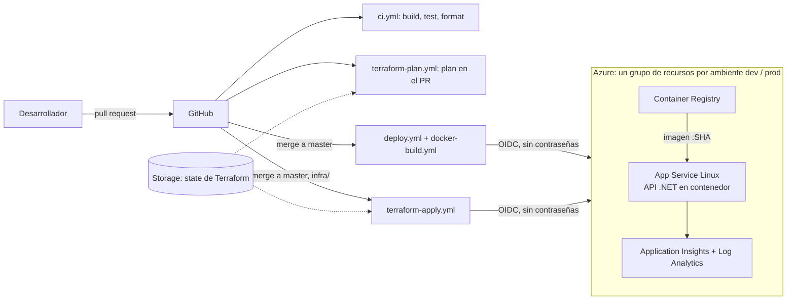

# api-monorepo-azure

Monorepo with a .NET 10 Web API (minimal API + Swagger).

## Laboratorio DevOps

Este repositorio también es un laboratorio práctico para aprender DevOps desde cero. Partiendo de una API mínima en .NET, se añaden paso a paso tests, contenedores con Docker, integración y entrega continuas con GitHub Actions, infraestructura como código con Terraform y despliegue en Azure. Cada capítulo explica los conceptos desde el principio, cómo ejecutar los comandos, qué salida esperar y qué errores son comunes. Si no sabes por dónde empezar, lee los capítulos en orden.

### Índice de la documentación

| Capítulo | Contenido |
| --- | --- |
| [00 - Glosario](docs/00-glosario.md) | Definición de todos los términos (CI, CD, runner, Terraform, OIDC...) |
| [01 - Requisitos y setup](docs/01-requisitos-y-setup.md) | Instalar y verificar las herramientas en Windows |
| [02 - Git y ramas](docs/02-git-y-ramas.md) | Flujo de ramas, Conventional Commits, pull requests y protección de ramas |
| [03 - La aplicación](docs/03-la-aplicacion.md) | La API, el endpoint `/health` y los archivos de configuración del repositorio |
| [04 - Testing](docs/04-testing.md) | Tests con xUnit, `tests/Api.Tests`, TDD y cómo ejecutarlos |
| [05 - Docker](docs/05-docker.md) | Imágenes, contenedores, Dockerfile multi-stage y cómo ejecutar la API en un contenedor |
| [06 - GitHub Actions](docs/06-github-actions.md) | Workflow de CI, triggers, permisos, caché, artefactos, Dependabot y protección de rama |
| [07 - Terraform: fundamentos](docs/07-terraform-fundamentos.md) | IaC, flujo init/plan/apply/destroy, state, providers y sintaxis HCL |
| [08 - Terraform: módulos](docs/08-terraform-modulos.md) | Por qué módulos y cada módulo (`resource_group`, `acr`, `monitoring`, `app_service`) explicado recurso por recurso |
| [09 - Terraform: ambientes y comandos](docs/09-terraform-ambientes-y-comandos.md) | `infra/envs/dev` y `prod`, comandos exactos, leer un plan, state, drift, errores y costos |
| [10 - Identidad OIDC](docs/10-azure-identidad-oidc.md) | Cómo GitHub entra a Azure sin contraseñas: app registration, credenciales federadas, roles, variables y environments |
| [11 - CD y ambientes](docs/11-cd-y-ambientes.md) | Workflows de build, deploy y Terraform plan/apply; aprobación de prod, smoke test y rollback |
| [12 - Costos, troubleshooting y ejercicios](docs/12-costos-troubleshooting-ejercicios.md) | Costos, cómo destruir todo, errores comunes, checklist final y 10 ejercicios |

### Arquitectura general



```
 codigo --> GitHub Actions --(OIDC)--> Azure
              |                          |-- ACR (imagenes :SHA)
              |                          |-- App Service (API en contenedor) --> /health
              |                          '-- Application Insights / Log Analytics
              '-- Terraform (state en Azure Storage): dev y prod por separado
```

### Ruta de aprendizaje

Lee y practica en este orden; cada capítulo asume los anteriores:

1. **Fundamentos**: [00 Glosario](docs/00-glosario.md) (consúltalo siempre), [01 Setup](docs/01-requisitos-y-setup.md), [02 Git](docs/02-git-y-ramas.md).
2. **La aplicación**: [03](docs/03-la-aplicacion.md) y [04 Testing](docs/04-testing.md). Aquí no hace falta Azure.
3. **Empaquetar y automatizar**: [05 Docker](docs/05-docker.md) y [06 GitHub Actions](docs/06-github-actions.md). Tampoco hace falta Azure.
4. **Infraestructura**: [07](docs/07-terraform-fundamentos.md), [08](docs/08-terraform-modulos.md) y [09](docs/09-terraform-ambientes-y-comandos.md). Puedes hacer `fmt` y `validate` gratis; `apply` ya cuesta dinero.
5. **Conectar todo**: [10 Identidad OIDC](docs/10-azure-identidad-oidc.md) y [11 CD](docs/11-cd-y-ambientes.md).
6. **Operar**: [12 Costos, troubleshooting y ejercicios](docs/12-costos-troubleshooting-ejercicios.md). Haz el presupuesto **antes** del primer `apply` y destruye todo al terminar.

> Estado de verificación: el código .NET, los tests y el CI se ejecutaron en local. La imagen Docker, Terraform (`fmt`/`validate`/`plan`), los scripts de Azure y los workflows de CD **no se han ejecutado** todavía en un entorno real; los YAML solo se validaron sintácticamente. Úsalos como laboratorio guiado y contrasta con la documentación oficial.

## Structure

```
.
├── Monorepo.slnx          # Solution file
└── apps/
    └── api/               # ASP.NET Core Web API (net10.0)
        ├── Program.cs
        ├── Health/        # GET /health endpoint
        └── Users/         # GET /user endpoint + response model
└── tests/
    └── Api.Tests/         # xUnit integration tests (WebApplicationFactory)
```

## Prerequisites

- [.NET SDK 10](https://dotnet.microsoft.com/download/dotnet/10.0) — verify with `dotnet --version`
- (Optional) Git

For HTTPS in local development, trust the dev certificate once:

```bash
dotnet dev-certs https --trust
```

## Commands

Run everything from the repository root.

```bash
# Restore dependencies
dotnet restore

# Build the whole solution
dotnet build

# Run the API (http://localhost:5251, https://localhost:7071)
dotnet run --project apps/api

# Run with the https profile
dotnet run --project apps/api --launch-profile https

# Run with hot reload
dotnet watch --project apps/api

# Release build / publish
dotnet build -c Release
dotnet publish apps/api -c Release -o ./publish

# Clean build outputs
dotnet clean
```

## Endpoints

| Method | Path    | Auth | Description              |
| ------ | ------- | ---- | ------------------------ |
| GET    | `/user` | None | Returns the list of users |
| GET    | `/health` | None | Returns `{"status":"Healthy"}` |

- Swagger UI: <http://localhost:5251/swagger>
- OpenAPI JSON: <http://localhost:5251/swagger/v1/swagger.json>

Quick test:

```bash
curl http://localhost:5251/user
```

Response item:

```json
{
  "name": "Juan",
  "paternalLastName": "Pérez",
  "maternalLastName": "García",
  "address": "Av. Reforma 123",
  "phone": "+52 55 1234 5678",
  "country": "Mexico",
  "city": "Mexico City",
  "permissions": ["read", "write", "delete"],
  "isActive": true
}
```

> The data is currently hardcoded in `apps/api/Users/UserEndpoints.cs`.

## Notes

- Swagger is only enabled in the Development environment.
- Change the port with `dotnet run --project apps/api --urls http://localhost:8080`.
- If a build fails with locked files, stop any running `Api.exe` process or run `dotnet build-server shutdown`.

## Adding more projects to the monorepo

```bash
# New project
dotnet new xunit -n Api.Tests -o tests/Api.Tests
dotnet add tests/Api.Tests reference apps/api

# Register it in the solution
dotnet sln add tests/Api.Tests

# Run all tests
dotnet test
```
