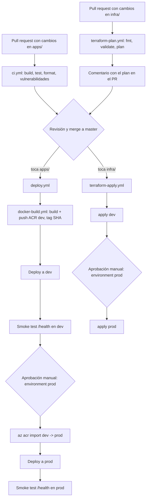

# 11 - CD: entrega continua y ambientes

Requisitos: capítulos [05](05-docker.md) (Docker), [06](06-github-actions.md) (CI), [09](09-terraform-ambientes-y-comandos.md) (Terraform) y [10](10-azure-identidad-oidc.md) (identidad OIDC y variables de GitHub). Los términos están en el [glosario](00-glosario.md).

> **Aviso de costos.** Desplegar crea/usa los recursos de `dev` (≈ 17-20 USD/mes si los dejas encendidos todo el mes; ver [capítulo 12](12-costos-troubleshooting-ejercicios.md)). `prod` es mucho más caro y está **apagado por defecto** (hasta que definas `ENABLE_PROD=true`).
>
> **Aviso de verificación.** Estos workflows se escribieron sin poder ejecutarlos: no se probó la imagen Docker (el daemon estaba apagado), no se ejecutó `actionlint` ni `terraform`, y no se lanzó nada en GitHub ni en Azure. Lo que sí se comprobó es que cada YAML es sintácticamente válido. Espera arreglar algún detalle en la primera ejecución; la tabla de errores del capítulo 12 te ayuda.

## 1. Qué es CD

**CI** (capítulo 06) responde "¿el código está bien?". **CD (Continuous Delivery/Deployment)** responde "¿cómo llega ese código, ya probado, a los servidores sin pasos manuales?". Aquí CD hace tres cosas: construye la imagen Docker, la publica en el ACR y la despliega en la App Service.

## 2. Mapa de workflows

| Archivo | Cuándo corre | Qué hace |
| --- | --- | --- |
| `ci.yml` (cap. 06) | Cada push y pull request | Compila, formatea, testea, escanea paquetes |
| `terraform-plan.yml` | Pull request que toca `infra/**` | `fmt`, `init`, `validate`, `plan`; comenta el plan en el PR |
| `terraform-apply.yml` | Push a master que toca `infra/**` | `apply` en dev y, tras aprobación, en prod |
| `docker-build.yml` | Lo llama `deploy.yml` (o a mano) | Construye la imagen y la sube al ACR con el SHA como tag |
| `deploy.yml` | Push a master que toca la app (o a mano) | Llama a `docker-build.yml`, despliega a dev, smoke test, aprobación, despliega a prod, smoke test |

## 3. El pipeline completo



Versión en ASCII:

```
 PR (apps/)  --> ci.yml ----------------------+
 PR (infra/) --> terraform-plan.yml           |
                 (plan comentado en el PR) ---+--> merge a master
                                                    |
              +-------------------------------------+------------------+
              | toca apps/                                   toca infra/ |
              v                                                          v
         deploy.yml                                            terraform-apply.yml
              |                                                          |
   docker-build.yml (push ACR dev :SHA)                        apply dev --> [aprobacion] --> apply prod
              |
   deploy dev --> smoke test
              |
        [aprobacion manual]
              |
   az acr import (dev -> prod) --> deploy prod --> smoke test
```

## 4. Primera vez: el orden correcto

Hay un detalle de "huevo y gallina": para publicar imágenes necesitas el ACR, y el ACR lo crea Terraform. Orden:

1. Bootstrap del state (cap. 07/09).
2. `terraform apply` local de `dev` (cap. 09): crea el grupo de recursos, ACR, App Service...
3. Script de identidad OIDC (cap. 10) y configuración de variables y environments de GitHub.
4. Sube tu rama, abre un PR, fusiona a master. Desde aquí lo hacen los workflows.
5. El primer despliegue a la web app: hasta entonces la web app mostraba error porque `api:latest` no existía; `docker-build.yml` publica también `latest`, así que arranca.

## 5. Secrets vs variables (y por qué casi no hay secrets)

| | **Variables** (`vars.X`) | **Secrets** (`secrets.X`) |
| --- | --- | --- |
| Para qué | Configuración no sensible | Contraseñas, claves, tokens |
| En los logs | Se muestran | GitHub las enmascara (`***`) |
| Dónde se definen | Repositorio o environment | Repositorio o environment |
| En este laboratorio | Client/tenant/subscription ID, nombres de ACR/app/grupo, cuenta del state, `ENABLE_PROD` | **Ninguno**: gracias a OIDC no hay contraseñas |

Niveles: una variable de **environment** tiene prioridad sobre una de **repositorio** con el mismo nombre, y solo la ven los jobs que declaran ese `environment`. Por eso `ACR_NAME` vale una cosa en `dev` y otra en `prod` y el workflow es idéntico.

El token del propio workflow, `GITHUB_TOKEN`, no lo defines tú: GitHub lo crea en cada ejecución con los permisos que pides en `permissions:`.

## 6. Environments

Un **environment** es un destino de despliegue con nombre (`dev`, `prod`). Cuando un job escribe `environment: prod`:

- Si el environment tiene *required reviewers*, el job **espera** hasta que alguien lo apruebe en la pantalla de la ejecución (botón *Review deployments*).
- El job ve las variables de ese environment.
- El token OIDC lleva el subject `...:environment:prod` (por eso Azure sabe que se trata de prod).
- GitHub registra el despliegue en la pestaña *Deployments* del repositorio, con enlace a la URL.

## 7. `docker-build.yml` explicado

Cada bloque, de arriba abajo (los comentarios en el YAML dicen lo mismo en pocas palabras):

| Parte | Qué hace y por qué |
| --- | --- |
| `on: workflow_call` | Convierte el workflow en "función" reutilizable que `deploy.yml` invoca con `uses:` |
| `on: workflow_dispatch` | Botón *Run workflow* manual |
| `permissions: id-token: write` | Permite pedir a GitHub el token OIDC. Sin esto: `Unable to get ACTIONS_ID_TOKEN_REQUEST_URL` |
| `environment: dev` | Da acceso a las variables de dev y fija el subject OIDC del login |
| `actions/checkout@v4` | Descarga el repositorio en el runner |
| `azure/login@v2` | Intercambia el token de GitHub por acceso a Azure. Solo recibe IDs (variables) |
| `docker/setup-buildx-action@v3` | Instala el motor de build moderno con cache |
| `az acr login` | Autentica Docker contra el ACR usando la sesión de Azure (token temporal) |
| `docker/build-push-action@v6` | Hace `docker build` + `docker push` en un paso. `context: .` y `file: apps/api/Dockerfile` equivalen a `docker build -f apps/api/Dockerfile .` del capítulo 05 |
| `tags:` con `github.sha` | Etiqueta inmutable: identifica el commit exacto. Es lo que se despliega |
| `tags:` con `latest` | Puntero móvil. Solo para que la primera arrancada funcione; **nunca** despliegues `latest` en serio (no sabrías qué versión corre) |
| `cache-from/to: type=gha` | Guarda capas en la caché de GitHub para acelerar builds siguientes |

*Versiones de acciones.* Se fijan por versión mayor (`@v4`, `@v6`…). Las acciones evolucionan y existen versiones mayores más recientes que las usadas aquí (por ejemplo `azure/login` ya tiene una `v3`); Dependabot (capítulo 06) abrirá PRs para actualizarlas. Para subir de versión, lee las *release notes* por si hay cambios incompatibles.

## 8. `deploy.yml` explicado

| Parte | Qué hace y por qué |
| --- | --- |
| `on.push.paths` | Solo reacciona a cambios de la app o su empaquetado; un cambio en `docs/` no despliega |
| `on.workflow_dispatch.inputs.image_tag` | Para **rollback**: SHA de una imagen ya publicada |
| `permissions: id-token: write` | Un workflow llamado nunca puede tener más permisos que quien lo llama, así que se concede aquí también |
| `concurrency: group: deploy`, `cancel-in-progress: false` | Despliegues en cola; jamás se corta uno a medias |
| `env.IMAGE_TAG` | La etiqueta a desplegar: la indicada a mano o `github.sha` |
| job `build` con `uses: ./.github/workflows/docker-build.yml` | Llama al workflow reutilizable. `if: inputs.image_tag == ''` lo omite en un rollback |
| job `deploy` con `strategy.matrix.environment` | El mismo job se ejecuta para `dev` y `prod`. `max-parallel: 1` los serializa en orden y `fail-fast: true` evita prod si dev falla |
| `fromJSON(vars.ENABLE_PROD == 'true' && ... )` | Prod solo existe en la matriz si activaste `ENABLE_PROD` (protección de costos) |
| `if: !cancelled() && needs.build.result != 'failure'` | Deja desplegar cuando `build` terminó bien **o** se omitió (rollback) |
| `environment: name: ${{ matrix.environment }}` | Aquí ocurre la aprobación manual de prod |
| paso *Import image into the prod registry* | Solo en prod: `az acr import` copia la imagen exacta del ACR de dev al de prod, sin descargarla al runner. Principio **build once, promote**: prod ejecuta los mismos bytes probados en dev |
| `azure/webapps-deploy@v3` | Cambia la imagen de la web app a `ACR/api:SHA`. La app la descarga con su identidad administrada (rol `AcrPull` creado por Terraform) |
| paso *Smoke test /health* | Pide `https://<host>/health` hasta 15 veces, cada 20 s (≈ 5 min). Éxito = HTTP 200. Si no, el paso falla y el despliegue se marca rojo |

¿Por qué reintentos? Tras el deploy, Azure tarda en descargar la imagen y arrancar el contenedor; la primera petición suele dar `502/503`. Un *smoke test* es una prueba mínima: no demuestra que todo funcione, solo que "humea" (arrancó).

> **Limitación conocida.** `deploy.yml` y `ci.yml` se disparan a la vez en un push a master. La garantía de que el código pasó CI viene de la **protección de rama** con *status checks* obligatorios (capítulo 02/06): solo se puede fusionar si CI está en verde.

## 9. `terraform-plan.yml` explicado

| Parte | Qué hace y por qué |
| --- | --- |
| `on.pull_request.paths: infra/**` | Solo corre si el PR toca infraestructura |
| `permissions: pull-requests: write` | Para poder comentar en el PR |
| `env.TF_IN_AUTOMATION`, `TF_INPUT=false` | Modo robot: sin preguntas interactivas |
| `env.TF_VAR_subscription_id` | Pasa la suscripción a Terraform (variable `subscription_id`) |
| job `format` | `terraform fmt -check -recursive -diff infra`: falla si hay archivos mal formateados y muestra la diferencia |
| `if: head.repo.full_name == github.repository` | Los PR desde forks no tienen OIDC: se saltan |
| `matrix.environment` | Un plan por ambiente |
| `defaults.run.working-directory` | Todos los comandos se ejecutan en `infra/envs/<ambiente>` |
| `terraform_wrapper: false` | Evita que `setup-terraform` altere la salida |
| `terraform init -backend-config=...` | Igual que en el capítulo 09, con valores de variables de GitHub |
| `terraform validate` | Comprueba sintaxis y coherencia sin hablar con Azure |
| `terraform plan -out=tfplan > plan-output.txt` | Calcula el plan sin aplicarlo y guarda la salida en un fichero. `continue-on-error: true` permite comentar el error si falla |
| paso `actions/github-script@v7` | Ejecuta JavaScript con la API de GitHub: lee el plan, lo recorta si pasa de 60 000 caracteres (límite de comentario: 65 536) y crea o **actualiza** un comentario por ambiente (busca un marcador oculto `<!-- terraform-plan-dev -->`) |
| último paso | Si el plan falló, hace fallar el job para que el check del PR quede en rojo |

Cómo revisar un plan en un PR: lee el resumen `Plan: X to add, Y to change, Z to destroy`; desconfía de cualquier `destroy` o `-/+` inesperado (capítulo 09, sección 4).

## 10. `terraform-apply.yml` explicado

| Parte | Qué hace y por qué |
| --- | --- |
| `on.push` a master con `paths: infra/**` | Aplica solo lo ya fusionado (y por tanto revisado) |
| `concurrency` sin cancelar | Dos `apply` simultáneos pelearían por el state; se hace cola |
| `matrix` + `max-parallel: 1` + `environment: ${{ matrix.environment }}` | dev primero, automático; prod después, esperando aprobación |
| `terraform plan -out=tfplan` y `terraform apply tfplan` | Se aplica exactamente el plan generado en ese momento. Mira el log del plan antes de aprobar prod |

Esto cumple "toda la infraestructura cambia por pull request": nadie hace `apply` desde su portátil salvo la primera vez.

## 11. Ejecutar y observar

1. Pestaña **Actions** del repositorio: lista de ejecuciones. Entra en una para ver los jobs; cada paso se despliega para ver su log.
2. Aprobar prod: en la ejecución aparece *Waiting for review*; el revisor pulsa **Review deployments**, marca `prod` y **Approve and deploy**.
3. Ver desplegado: `terraform -chdir=infra/envs/dev output -raw app_url` y abre `<url>/health`; debe mostrar `{"status":"Healthy"}`.

## 12. Rollback: volver a una versión anterior

Como cada imagen se etiqueta con el SHA del commit y permanece en el ACR, volver atrás es **redesplegar un SHA anterior**, sin recompilar:

1. Localiza el SHA bueno: `git log --oneline` o las ejecuciones anteriores de *Deploy*; o lista las etiquetas del ACR:

```powershell
az acr repository show-tags --name <ACR_NAME> --repository api --orderby time_desc --top 10 --output table
```

2. En GitHub: **Actions** → *Deploy* → **Run workflow** → rama `master` → `image_tag` = SHA completo (40 caracteres) → *Run*.
3. El workflow salta la construcción, despliega ese SHA en dev, espera tu aprobación para prod, lo importa y lo despliega.

Después arregla el problema en una rama nueva y haz un PR normal (el rollback es una medida de emergencia, no un reemplazo del flujo).

Notas: el rollback de **infraestructura** no es redesplegar: es revertir el commit en `infra/` (`git revert`) y dejar que `terraform-apply` aplique el estado anterior.

## 13. Errores comunes

| Mensaje / síntoma | Causa y solución |
| --- | --- |
| `Unable to get ACTIONS_ID_TOKEN_REQUEST_URL` | Falta `id-token: write` en el workflow que **llama** (no solo en el llamado) |
| `AADSTS70021: No matching federated identity record` | El subject no coincide con una credencial; ver capítulo 10 sección 8 |
| El job de prod se queda en "Waiting" | Es lo esperado: falta que un revisor lo apruebe |
| El job de prod ni aparece | `ENABLE_PROD` no vale `true` |
| `denied: requested access to the resource is denied` en push | Falta `AcrPush` sobre el ACR, o `ACR_NAME` vacío (¿lo definiste en el environment?) |
| `The ACR login server ... .azurecr.io` aparece como `.azurecr.io` sin nombre | `vars.ACR_NAME` vacío: la variable no está en el environment `dev` |
| `az acr import` falla con `AuthorizationFailed` | La identidad necesita permisos sobre el ACR de dev (lectura) y de prod (`AcrPush`); ver script de identidad |
| Smoke test: HTTP 000 / 502 / 503 durante minutos | El contenedor no arranca: revisa el log del contenedor (capítulo 12) y que el puerto sea 8080 |
| `Error acquiring the state lock` | Otro `plan/apply` activo; espera o ver capítulo 09 sección 5 |
| El comentario del plan no aparece | Falta `pull-requests: write` o el PR viene de un fork |
